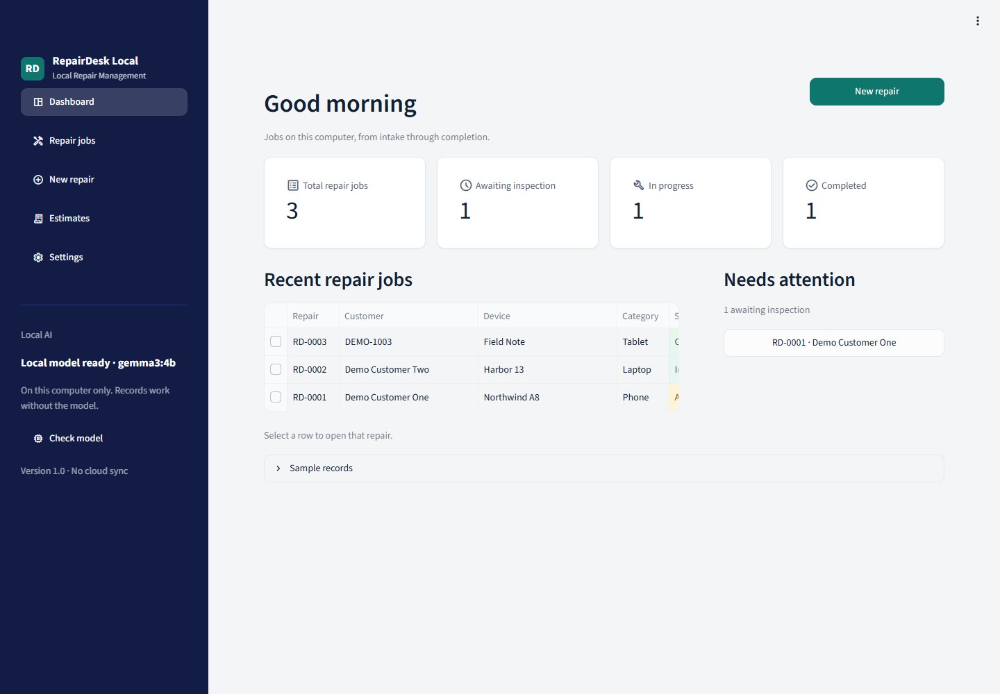
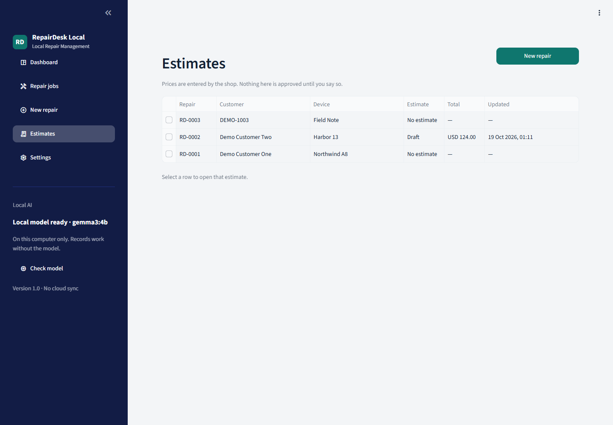
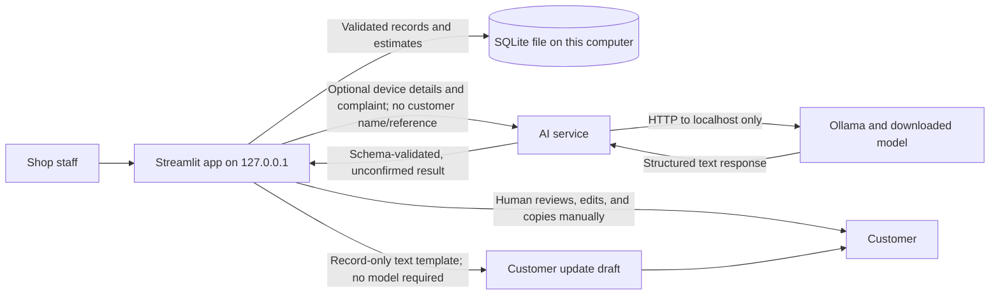
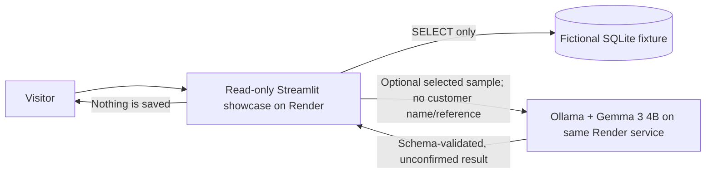

# RepairDesk Local

RepairDesk Local is an offline-first repair-shop desk for tracking device repairs, preparing estimates, and drafting customer updates. Shop records are stored in a local SQLite database. Optional AI assistance runs through Ollama on the same computer; the application does not send records to a cloud AI service.

> **Important:** AI output is an unconfirmed intake aid, not a diagnosis. Review every draft before sharing it. The app never sends customer updates, approves estimates, or chooses prices for you. Do not enter passwords, PINs, or device unlock codes.

## Screenshots and demo

The screenshots and short, silent walkthrough use only fictional sample records.





[Watch the short demonstration video](docs/demo/RepairDesk-Local-Demo.mp4).

### Public Render demo

The public demo is a separate, read-only Streamlit app with a dedicated SQLite
fixture containing only fictional jobs. Its optional Gemma 3 4B intake analysis
runs in Ollama inside the same Render service. It accepts no user-entered
records, does not change the sample data, and does not save model output. The
full local installation below remains the private shop workflow.

The Blueprint uses a paid 4-CPU/8-GB Render web service and a 10-GB persistent
disk for the model. Render listed this compute plan at $175/month on October
19, 2026; disk is billed separately. At continuous runtime, six days of
compute is about $35 before disk and other charges. The service does not sleep
while idle. Creating it starts billing. Claim and verify any Render credits
before creating the service, check the current [Render pricing](https://render.com/pricing),
and manually suspend the service within six days of its first billable start
to stay within a $50 credit budget. The Blueprint cannot enforce a dollar cap,
and Render may bill a payment method if the credit is exhausted. Hacktoberfest
credit claims are managed through the
[Hacktoberfest account page](https://hacktoberfest.com/my).

[](https://render.com/deploy?repo=https://github.com/Dev-Nidhan/repairdesk-local)

To preview the read-only showcase locally, generate its fictional fixture and
start the app:

```powershell
python prepare_demo.py
streamlit run demo_app.py
```

Hosted AI is off by default for this local preview. To test it with a local
Ollama instance, set `REPAIRDESK_DEMO_AI=true` before starting Streamlit.

On its first start, the container downloads `gemma3:4b` to the persistent disk;
later restarts reuse that download. The demo only analyzes one of its fictional
sample records. The selected record's device and complaint details are sent to
Ollama running on the Render host. Never enter real customer information in
this public site.

## Features

- Track repair jobs from intake through inspection, work in progress, and completion.
- Search and edit records with customer references, device details, reported issues, and technician notes.
- Prepare itemized parts and labour estimates using prices entered by the technician.
- Create a customer update from the repair record, then review and copy it yourself.
- Optionally ask a local Ollama model for an unconfirmed intake checklist or a rewrite of an update.
- Load clearly fictional sample jobs only after confirming in the app.

## Requirements

- Python 3.11 or newer
- pip
- Optional AI features: [Ollama](https://ollama.com/download) and a downloaded model (the default is `gemma3:4b`)

Installing Python packages and downloading the optional model require a network connection. Once installed, job management and Ollama inference can run locally without an internet connection.

The package ranges are defined in [`requirements.txt`](requirements.txt):

| Package | Used for |
| --- | --- |
| `streamlit` | Local web interface |
| `requests` | HTTP requests to the configured Ollama endpoint |
| `pydantic` | Validation of job and model-response data |
| `python-dotenv` | Optional `.env` configuration |
| `pytest` | Running the test suite |

SQLite comes from Python's standard library; there is no separate database server to install.

## Installation

### Windows (PowerShell)

```powershell
git clone https://github.com/Dev-Nidhan/repairdesk-local.git
cd repairdesk-local
python -m venv .venv
.\.venv\Scripts\Activate.ps1
python -m pip install --upgrade pip
pip install -r requirements.txt
Copy-Item .env.example .env
```

If PowerShell blocks virtual-environment activation, run the commands using `.\.venv\Scripts\python.exe` instead of activating the environment.

### macOS and Linux

```bash
git clone https://github.com/Dev-Nidhan/repairdesk-local.git
cd repairdesk-local
python3 -m venv .venv
source .venv/bin/activate
python -m pip install --upgrade pip
pip install -r requirements.txt
cp .env.example .env
```

The database is created automatically on first launch. No real or pre-populated customer database is included in this repository.

## Configuration

The app reads optional values from `.env` in the project directory. Start from `.env.example` and keep your `.env` file private.

| Variable | Default | Purpose |
| --- | --- | --- |
| `OLLAMA_BASE_URL` | `http://localhost:11434` | Local Ollama HTTP endpoint |
| `OLLAMA_MODEL` | `gemma3:4b` | Model name as shown by `ollama list` |
| `REPAIRDESK_DB_PATH` | `repairdesk.db` | SQLite database path; relative paths are resolved from the project directory |
| `REPAIRDESK_CURRENCY` | `INR` for a new database; `USD` when opening a non-empty database and unset | Currency label only; changing it does not convert stored amounts |

Example:

```dotenv
OLLAMA_BASE_URL=http://localhost:11434
OLLAMA_MODEL=gemma3:4b
REPAIRDESK_DB_PATH=repairdesk.db
# REPAIRDESK_CURRENCY=INR
```

## Optional local AI setup

Install and start Ollama, then download the model configured in `.env`:

```powershell
ollama pull gemma3:4b
ollama list
```

Use `OLLAMA_MODEL` to match the exact model name reported by `ollama list`. The app's sidebar reports whether Ollama is unreachable, the model is missing, or the model is ready. AI features remain optional; the repair desk, estimates, and template-based updates still work without Ollama.

### Local AI workflow



The normal record and estimate workflow is deterministic Python backed by SQLite. When asked, `ai_service.py` sends device details and the reported complaint to the configured local Ollama endpoint. It deliberately omits the customer name and reference; customer and technician text is treated as untrusted input. The response is validated against Pydantic schemas before it can be saved. Model suggestions remain explicitly unconfirmed and cannot set a price, approve work, or send a message. A customer update can instead be built from the record without using a model. In every case, a person reviews and shares the text outside the app.

The Render showcase is a separate, read-only path:



The hosted page has no intake fields or mutation controls. AI results are
generated only for the selected fictional sample and are not stored. This
public, paid deployment is for evaluation; for real customer records, use the
local installation and keep Ollama on a machine you control.

## Run the app

```powershell
streamlit run app.py
```

The app listens on `127.0.0.1` by default. To use a different port:

```powershell
streamlit run app.py --server.port 8502
```

In the **Sample records** section on the dashboard, confirm **Add fictional sample jobs** to load the examples. The samples are generated by `demo_data.py`, are not inserted at startup, and do not include AI analyses.

## Tests

```powershell
python -m pytest
```

The test suite uses temporary SQLite databases and does not call a live Ollama model.

## Privacy and secrets

- Repair records stay in the configured SQLite file unless you manually copy or expose it.
- The app binds to localhost and does not sync records or call a cloud AI API.
- Optional model requests go to the configured Ollama URL. Use a local endpoint you control.
- `.env`, Streamlit secrets, SQLite databases, model files, and virtual environments are excluded by `.gitignore`. Never commit them.
- Only fictional examples belong in screenshots, recordings, tests, and issue reports. Inspect media before sharing it; do not capture real customer names, references, complaints, or database paths that reveal personal information.
- Do not enter credentials or device unlock codes into repair records. Rotate any secret that is accidentally committed; deleting it in a later commit does not remove it from Git history.

## Limitations

- There is no multi-computer sync or automatic backup. Back up the database securely yourself.
- The optional model must already be downloaded to work offline. Local model speed and quality depend on your hardware.
- Model output may be incomplete or wrong. It is not a diagnosis and must be reviewed.
- Customer updates are drafts only. The app never transmits them.
- The built-in safety checks are not a substitute for technician training or safe working procedures.

## Project structure

| Path | Responsibility |
| --- | --- |
| `app.py` | Streamlit interface, settings, and user workflow |
| `database.py` | SQLite schema and data operations |
| `ai_service.py` | Local Ollama status checks, prompts, and response validation |
| `schemas.py` | Job and AI-response validation |
| `estimates.py` | Estimate line parsing and price calculations |
| `customer_updates.py` | Record-based customer update templates and safeguards |
| `demo_data.py` | Explicitly loaded fictional sample jobs |
| `demo_app.py` | Separate read-only hosted showcase with optional sample-only AI |
| `prepare_demo.py` | Creates the fictional showcase fixture during image build |
| `Dockerfile`, `start_demo.sh` | Container image and Ollama/Streamlit startup |
| `render.yaml` | Paid Render Blueprint with persistent model storage |
| `requirements.txt` | Python package dependencies |
| `tests/` | Unit and database tests |

## Contributing

Bug reports, documentation improvements, and focused pull requests are welcome. See [CONTRIBUTING.md](CONTRIBUTING.md) for the development workflow and privacy expectations.

## License

This project is licensed under the [MIT License](LICENSE).
